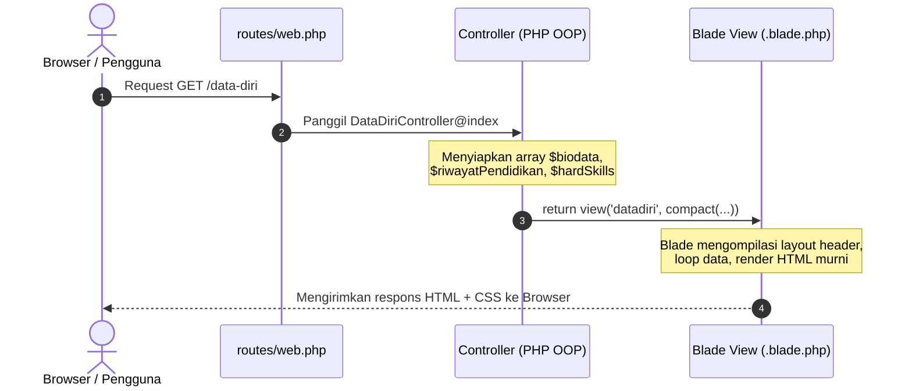

# PANDUAN LENGKAP: PEMAHAMAN, PRESENTASI & CHEAT SHEET MODIFIKASI KODE
**Aplikasi Portofolio Web Berbasis Framework Laravel**
*Mahasiswa: Zala Risky Pratama (NIM: 2024150064) • Pemrograman Web Semester 5*

---

## DAFTAR ISI
1. [Peta Arsitektur & Cara Kerja Laravel (Wajib Paham)](#1-peta-arsitektur--cara-kerja-laravel)
2. [Bedah Struktur File & Peran Masing-Masing](#2-bedah-struktur-file--peran-masing-masing)
3. [Alur Passing Data: Controller ke Blade View](#3-alur-passing-data-controller-ke-blade-view)
4. [Sistem Desain Noir & Platinum (Hitam Putih Elegan)](#4-sistem-desain-noir--platinum)
5. [Naskah Alur Presentasi di Depan Dosen](#5-naskah-alur-presentasi-di-depan-dosen)
6. [Prediksi Pertanyaan Dosen & Cara Menjawabnya](#6-prediksi-pertanyaan-dosen--cara-menjawabnya)
7. [Cheat Sheet Cepat: "Jika Disuruh Mengubah Kode di Tempat"](#7-cheat-sheet-cepat-jika-disuruh-mengubah-kode)

---

## 1. PETA ARSITEKTUR & CARA KERJA LARAVEL

Saat seseorang membuka URL di browser (misalnya `https://zala_laravel.test/data-diri`), berikut urutan eksekusi yang terjadi:



### Konsep Penting yang Harus Dipahami:
1. **MVC (Model-View-Controller)**:
   - **Model**: Mengelola data & database (Eloquent).
   - **View**: Tampilan antarmuka yang dilihat user (`resources/views/`).
   - **Controller**: "Otak" penghubung logic, menyiapkan data sebelum dilempar ke View (`app/Http/Controllers/`).
2. **Kompilasi Blade**:
   File `.blade.php` **bukan** file statis biasa. Laravel mengompilasinya menjadi kode PHP native berkecepatan tinggi yang disimpan dalam cache (`storage/framework/views/`).

---

## 2. BEDAH STRUKTUR FILE & PERAN MASING-MASING

| Lokasi File | Fungsi & Peran | Kapan Harus Diedit? |
|---|---|---|
| [`routes/web.php`](file:///home/nocturn/Projects/Semester%205/Pemrograman%20Web/zala_laravel/routes/web.php) | Daftar rute URL aplikasi | Saat ingin menambah halaman baru atau mengganti URL |
| [`app/Http/Controllers/BerandaController.php`](file:///home/nocturn/Projects/Semester%205/Pemrograman%20Web/zala_laravel/app/Http/Controllers/BerandaController.php) | Menyediakan data ucapan salam, ringkasan akademik, dan fokus keahlian | Saat ingin mengganti teks perkenalan atau daftar keahlian di Beranda |
| [`app/Http/Controllers/DataDiriController.php`](file:///home/nocturn/Projects/Semester%205/Pemrograman%20Web/zala_laravel/app/Http/Controllers/DataDiriController.php) | Menyediakan array `$biodata`, `$riwayatPendidikan`, `$hardSkills` | Saat ingin memperbarui data profil, riwayat sekolah, atau persentase skill |
| [`app/Http/Controllers/AktivitasController.php`](file:///home/nocturn/Projects/Semester%205/Pemrograman%20Web/zala_laravel/app/Http/Controllers/AktivitasController.php) | Menyediakan array daftar tugas, praktikum, dan status proyek | Saat ingin menambah proyek atau mengganti status tugas |
| [`app/Http/Controllers/KontakController.php`](file:///home/nocturn/Projects/Semester%205/Pemrograman%20Web/zala_laravel/app/Http/Controllers/KontakController.php) | Menyediakan data media sosial & menangani validasi pengiriman pesan via POST | Saat ingin mengubah nomor WA/GitHub atau mengubah aturan validasi form |
| [`resources/views/layouts/header.blade.php`](file:///home/nocturn/Projects/Semester%205/Pemrograman%20Web/zala_laravel/resources/views/layouts/header.blade.php) | Master layout atas: `<head>`, Favicon, loader CSS (`@vite`), Navbar, Logo Skull | Saat ingin mengubah navigasi navbar atau logo aplikasi |
| [`resources/views/layouts/footer.blade.php`](file:///home/nocturn/Projects/Semester%205/Pemrograman%20Web/zala_laravel/resources/views/layouts/footer.blade.php) | Master layout bawah: Penutup `</main>`, Footer identitas NIM, inisialisasi script Feather Icons | Saat ingin mengubah footer atau menambahkan script JS |
| [`resources/css/app.css`](file:///home/nocturn/Projects/Semester%205/Pemrograman%20Web/zala_laravel/resources/css/app.css) | Master stylesheet entry point (mengimpor seluruh file CSS modular) | Saat ingin menambah atau mendaftarkan modul CSS baru |
| [`resources/css/variables.css`](file:///home/nocturn/Projects/Semester%205/Pemrograman%20Web/zala_laravel/resources/css/variables.css) | Token desain & variabel CSS `:root` (Noir & Platinum, warna, glow) | Saat ingin mengganti warna tema, aksen border-glow, atau warna teks |
| [`resources/css/layout.css`](file:///home/nocturn/Projects/Semester%205/Pemrograman%20Web/zala_laravel/resources/css/layout.css) | Tata letak global, container, reset dasar, navbar, dan footer | Saat ingin mengubah struktur tata letak dasar atau ukuran navbar |
| [`resources/css/components.css`](file:///home/nocturn/Projects/Semester%205/Pemrograman%20Web/zala_laravel/resources/css/components.css) | Komponen UI: `.glass-card`, `.btn-modern`, `.tag-pill`, `.code-box` | Saat ingin memodifikasi efek kartu kaca, tombol, atau badge |
| [`resources/css/responsive.css`](file:///home/nocturn/Projects/Semester%205/Pemrograman%20Web/zala_laravel/resources/css/responsive.css) | Media query responsif untuk breakpoint tablet & smartphone | Saat ingin mengatur perilaku tampilan mobile/tablet |
| [`resources/views/beranda.blade.php`](file:///home/nocturn/Projects/Semester%205/Pemrograman%20Web/zala_laravel/resources/views/beranda.blade.php) | Tampilan Beranda (Hero, Logo Skull Emblem, 3 Grid Statistik, Tech List) | Mengubah tata letak kartu Beranda |
| [`resources/views/datadiri.blade.php`](file:///home/nocturn/Projects/Semester%205/Pemrograman%20Web/zala_laravel/resources/views/datadiri.blade.php) | Tampilan Profil Mahasiswa, Tabel Akademik, Progress Bar Skill | Mengubah tampilan kartu identitas diri |
| [`resources/views/aktivitas.blade.php`](file:///home/nocturn/Projects/Semester%205/Pemrograman%20Web/zala_laravel/resources/views/aktivitas.blade.php) | Tampilan kartu proyek dengan badge status dan tags | Mengubah desain kartu aktivitas |
| [`resources/views/kontak.blade.php`](file:///home/nocturn/Projects/Semester%205/Pemrograman%20Web/zala_laravel/resources/views/kontak.blade.php) | Formulir interaktif POST dan kartu saluran media sosial | Mengubah input field formulir pesan |
| [`resources/views/halo.blade.php`](file:///home/nocturn/Projects/Semester%205/Pemrograman%20Web/zala_laravel/resources/views/halo.blade.php) | Halaman pengantar edukasi sintaks Blade & alur kerja MVC | Panduan teori Blade untuk dosen |
| [`public/images/logo.png`](file:///home/nocturn/Projects/Semester%205/Pemrograman%20Web/zala_laravel/public/images/logo.png) | File fisik gambar logo tengkorak pixel | Saat ingin mengganti gambar logo aplikasi |

---

## 3. ALUR PASSING DATA: CONTROLLER KE BLADE VIEW

### Bagaimana Data Berpindah?
1. **Di Controller** ([`DataDiriController.php`](file:///home/nocturn/Projects/Semester%205/Pemrograman%20Web/zala_laravel/app/Http/Controllers/DataDiriController.php)):
   ```php
   $biodata = [
       'nama' => 'Zala Risky Pratama',
       'nim'  => '2024150064'
   ];
   return view('datadiri', compact('biodata'));
   ```
   *Fungsi `compact('biodata')` mengemas variabel PHP `$biodata` menjadi pasangan key-value `['biodata' => $biodata]`.*

2. **Di Blade View** ([`datadiri.blade.php`](file:///home/nocturn/Projects/Semester%205/Pemrograman%20Web/zala_laravel/resources/views/datadiri.blade.php)):
   ```blade
   <h2>{{ $biodata['nama'] }}</h2>
   <p>NIM: {{ $biodata['nim'] }}</p>
   ```

### Sintaks Blade Kunci:
- `{{ $variabel }}`: Mencetak data teks dengan sanitasi XSS (`htmlspecialchars`) otomatis.
- `{!! $kontenHtml !!}`: Mencetak teks tanpa filter (raw HTML).
- `@foreach($hardSkills as $skill) ... @endforeach`: Melakukan looping array.
- `@forelse($daftarAktivitas as $act) ... @empty ... @endforelse`: Looping array dengan penanganan fallback otomatis jika array kosong.
- `@if(...) ... @elseif(...) ... @else ... @endif`: Logika percabangan kondisional.
- `@include('layouts.header', ['title' => '...'])`: Menyisipkan partial view sekaligus mengirimkan variabel.

---

## 4. SISTEM DESAIN NOIR & PLATINUM (HITAM PUTIH ELEGAN)

Seluruh kode CSS telah **dipisahkan secara modular ke dalam folder [`resources/css/`](file:///home/nocturn/Projects/Semester%205/Pemrograman%20Web/zala_laravel/resources/css)** agar bersih, terorganisir, dan mudah dipelajari (Separation of Concerns):

### Struktur Modul CSS (`resources/css/`):
1. **[`variables.css`](file:///home/nocturn/Projects/Semester%205/Pemrograman%20Web/zala_laravel/resources/css/variables.css)**: Token desain `:root` (palet warna Noir & Platinum, background, border-glow).
2. **[`layout.css`](file:///home/nocturn/Projects/Semester%205/Pemrograman%20Web/zala_laravel/resources/css/layout.css)**: Reset global `*`, tipografi body, container, sticky navbar, brand badge logo, dan footer.
3. **[`components.css`](file:///home/nocturn/Projects/Semester%205/Pemrograman%20Web/zala_laravel/resources/css/components.css)**: Komponen kartu kaca (`.glass-card`), gradien perak (`.gradient-text`), tag pills, dan tombol (`.btn-modern`).
4. **[`responsive.css`](file:///home/nocturn/Projects/Semester%205/Pemrograman%20Web/zala_laravel/resources/css/responsive.css)**: Penyesuaian tampilan responsif tablet & mobile (`@media (max-width: 768px)`, `820px`, `860px`).
5. **[`app.css`](file:///home/nocturn/Projects/Semester%205/Pemrograman%20Web/zala_laravel/resources/css/app.css)**: Entry point utama yang mengimpor seluruh modul di atas menggunakan `@import`.

Di layout Blade ([`resources/views/layouts/header.blade.php`](file:///home/nocturn/Projects/Semester%205/Pemrograman%20Web/zala_laravel/resources/views/layouts/header.blade.php)), CSS dimuat secara otomatis menggunakan Vite Asset Bundler:
```blade
@if (file_exists(public_path('build/manifest.json')) || file_exists(public_path('hot')))
    @vite(['resources/css/app.css'])
@else
    <link rel="stylesheet" href="{{ asset('css/app.css') }}">
@endif
```

### Variabel Warna Utama (`resources/css/variables.css`):
```css
:root {
    --bg-body: #050505;              /* Hitam pekat dasar */
    --bg-card: rgba(16, 16, 18, 0.75); /* Smoked glass transparan */
    --border-glass: rgba(255, 255, 255, 0.1);  /* Garis kaca halus */
    --border-glow: rgba(255, 255, 255, 0.35);  /* Cahaya putih saat hover */
    
    --primary: #ffffff;             /* Putih murni */
    --primary-light: #e4e4e7;       /* Perak platinum terang */
    --text-heading: #ffffff;        /* Judul teks putih kontras tinggi */
    --text-body: #a1a1aa;           /* Teks konten abu-abu nyaman */
    --text-muted: #71717a;          /* Teks sekunder/keterangan */
}
```

### Efek Visual Utama:
1. **Glassmorphism Smoked Glass**: `backdrop-filter: blur(18px)` menghasilkan efek kaca kabut mewah di atas latar belakang gelap (`components.css`).
2. **Platinum Gradient Text**: `linear-gradient(135deg, #ffffff 0%, #e4e4e7 45%, #a1a1aa 100%)` memberi efek kilau logam perak pada judul (`components.css`).
3. **Contrast Buttons**: Tombol utama berwarna putih solid dengan teks hitam tajam (`#050505`) dan efek white aura glow saat hover (`components.css`).
4. **Logo Showcase Emblem**: Logo pixel skull dibingkai menggunakan border rounded dengan efek `contrast` dan bayangan lembut (`layout.css`).

---

## 5. NASKAH ALUR PRESENTASI DI DEPAN DOSEN

Gunakan tahapan ini untuk presentasi yang profesional, terstruktur, dan percaya diri:

### 1. Pembukaan (30 Detik)
> *"Assalamu’alaikum Wr. Wb. / Selamat pagi Bapak/Ibu Dosen. Perkenalkan saya Zala Risky Pratama, NIM 2024150064. Hari ini saya akan mempresentasikan proyek portofolio web berbasis framework Laravel yang telah saya bangun untuk mata kuliah Pemrograman Web Berbasis Framework di Semester 5."*

### 2. Penjelasan Konsep & Arsitektur (1 Menit)
> *"Aplikasi ini dibangun menggunakan arsitektur MVC (Model-View-Controller). Seluruh data disiapkan secara terstruktur di Controller masing-masing halaman dan dikirimkan ke Blade View menggunakan metode `compact()`. Saya memisahkan layout menjadi modul reusable (`layouts.header` dan `layouts.footer`) agar prinsip DRY (Don't Repeat Yourself) terpenuhi."*

### 3. Demo Halaman per Halaman (2-3 Menit)
- **Beranda**: Tunjukkan hero section dengan logo emblem pixel skull, 3 kartu ringkasan mahasiswa (NIM, Semester, Mata Kuliah), serta daftar keahlian.
- **Data Diri**: Tunjukkan profil mahasiswa, rincian data akademik dalam grid, progress bar skill perak, dan timeline riwayat pendidikan.
- **Aktivitas**: Jelaskan penggunaan `@forelse` yang menampilkan kartu rekap tugas dengan badge status dinamis (Selesai, Aktif, Menunggu).
- **Kontak**: Tunjukkan saluran komunikasi dan formulir pengiriman pesan yang memiliki validasi `POST` (`required`, `email`, `min`).
- **Pengantar**: Jelaskan bahwa halaman ini berfungsi sebagai rangkuman edukatif mengenai cara kerja sintaks Blade dan alur MVC di Laravel.

### 4. Penutup (30 Detik)
> *"Untuk tema tampilan, saya menerapkan konsep Noir & Platinum (Monokromatik Elegan) dengan pure Vanilla CSS dan glassmorphism agar antarmuka terlihat modern, berkelas, dan memiliki identitas kuat. Demikian presentasi saya, saya siap menerima pertanyaan maupun pengujian kode dari Bapak/Ibu. Terima kasih."*

---

## 6. PREDIKSI PERTANYAAN DOSEN & CARA MENJAWABNYA

### Q1: "Kenapa kamu pakai Controller terpisah dan tidak langsung menulis datanya di `routes/web.php`?"
> **Jawaban:** *"Praktik terbaik (best practice) di Laravel mengedepankan Separation of Concerns. Rute bertugas hanya untuk pemetaan URL (routing), sedangkan penyiapan data, manipulasi array, dan logika bisnis harus berada di Controller. Hal ini membuat kode modular, mudah di-test, dan mudah dikembangkan jika nantinya terhubung ke database/Model."*

### Q2: "Bagaimana cara logo tengkorak dan tema warna diubah?"
> **Jawaban:** *"File logo ditaruh di folder `public/images/logo.png` dan dipanggil menggunakan helper asset `asset('images/logo.png')`. Sedangkan sistem warnanya diatur terpusat menggunakan CSS Custom Properties (`:root`) di file `resources/css/variables.css`. File ini diimpor oleh `resources/css/app.css` dan dibundle oleh Vite. Jika kita mengubah satu variabel warna di `:root`, seluruh komponen kartu, teks, dan tombol akan otomatis menyesuaikan."*

### Q3: "Apa bedanya `{{ $data }}` dengan `{!! $data !!}` di Blade?"
> **Jawaban:** *"Sintaks kurung kurawal ganda `{{ }}` secara otomatis membungkus teks dengan fungsi PHP `htmlspecialchars()`, sehingga aman dari serangan XSS (Cross-Site Scripting). Sedangkan `{!! !!}` akan merender raw HTML tanpa penyaringan apa pun, yang hanya digunakan jika kita yakin kontennya aman (misalnya konten dari text editor terverifikasi)."*

### Q4: "Bagaimana alur validasi pada form Kontak?"
> **Jawaban:** *"Saat formulir disubmit dengan method POST ke route `kontak.kirim`, method `kirimPesan(Request $request)` di `KontakController` menjalankan `$request->validate()`. Jika input tidak sesuai aturan (misal email tidak valid atau nama kurang dari 3 karakter), Laravel otomatis me-redirect kembali user dengan pesan error di variabel `$message` dan mempertahankan input lama dengan `old()`."*

---

## 7. CHEAT SHEET CEPAT: "JIKA DISURUH MENGUBAH KODE"

Gunakan contekan ini jika dosen meminta Anda live-coding:

---

### SKENARIO A: "Coba ganti Nama / NIM / Biodata Anda"
1. Buka file: [`app/Http/Controllers/DataDiriController.php`](file:///home/nocturn/Projects/Semester%205/Pemrograman%20Web/zala_laravel/app/Http/Controllers/DataDiriController.php)
2. Ubah baris 10-11:
   ```php
   'nama' => 'Nama Baru Anda',
   'nim' => 'NIM Baru Anda',
   ```
3. Buka file: [`app/Http/Controllers/BerandaController.php`](file:///home/nocturn/Projects/Semester%205/Pemrograman%20Web/zala_laravel/app/Http/Controllers/BerandaController.php)
4. Ubah baris 11-12:
   ```php
   $nama = 'Nama Baru Anda';
   $nim = 'NIM Baru Anda';
   ```
5. Buka browser dan lakukan **Refresh (F5)**.

---

### SKENARIO B: "Coba tambahkan Keahlian / Skill Baru"
1. Buka file: [`app/Http/Controllers/DataDiriController.php`](file:///home/nocturn/Projects/Semester%205/Pemrograman%20Web/zala_laravel/app/Http/Controllers/DataDiriController.php)
2. Pada array `$hardSkills` (baris 38-45), tambahkan baris baru:
   ```php
   ['nama' => 'Cyber Security', 'level' => '90%'],
   ```
3. Refresh halaman Data Diri. Progress bar baru akan langsung otomatis muncul!

---

### SKENARIO C: "Coba tambahkan Proyek / Aktivitas Baru"
1. Buka file: [`app/Http/Controllers/AktivitasController.php`](file:///home/nocturn/Projects/Semester%205/Pemrograman%20Web/zala_laravel/app/Http/Controllers/AktivitasController.php)
2. Tambahkan elemen array baru pada `$daftarAktivitas`:
   ```php
   [
       'judul' => 'Sistem Informasi Akademik Mini',
       'kategori' => 'Tugas Besar',
       'status' => 'Aktif',
       'tanggal' => 'Oktober 2026',
       'deskripsi' => 'Pengembangan modul autentikasi dan CRUD data mahasiswa.',
       'tags' => ['Laravel', 'CRUD', 'Auth'],
       'icon' => 'box'
   ],
   ```
3. Refresh halaman Aktivitas. Kartu baru akan otomatis ter-render.

---

### SKENARIO D: "Coba buat Halaman Baru (Misal: Prestasi atau Galeri)"
Jika dosen menantang: *"Coba buat halaman baru sekarang!"*, lakukan 4 langkah cepat ini:

**Langkah 1: Tambahkan Route**
Buka [`routes/web.php`](file:///home/nocturn/Projects/Semester%205/Pemrograman%20Web/zala_laravel/routes/web.php), tambahkan:
```php
Route::get('/prestasi', function () {
    $daftarPrestasi = [
        'Juara 1 Lomba Web Design Tingkat Kampus 2025',
        'Peserta Sertifikasi Kompetensi Junior Web Developer'
    ];
    return view('prestasi', compact('daftarPrestasi'));
})->name('prestasi');
```

**Langkah 2: Buat View Baru**
Buat file baru di `resources/views/prestasi.blade.php`:
```blade
@include('layouts.header', ['title' => 'Prestasi • Portofolio'])
<div class="container">
    <div class="glass-card">
        <h1 style="color: var(--text-heading); margin-bottom: 1rem;">Daftar Prestasi</h1>
        <ul>
            @foreach($daftarPrestasi as $item)
                <li style="color: var(--text-body); margin-bottom: 0.5rem;">🏆 {{ $item }}</li>
            @endforeach
        </ul>
    </div>
</div>
@include('layouts.footer')
```

**Langkah 3: Tambahkan Menu di Navbar (Opsional)**
Buka [`resources/views/layouts/header.blade.php`](file:///home/nocturn/Projects/Semester%205/Pemrograman%20Web/zala_laravel/resources/views/layouts/header.blade.php), tambahkan `<li>` di `<ul class="nav-menu">`:
```blade
<li>
    <a href="{{ route('prestasi') }}" class="nav-link {{ request()->routeIs('prestasi') ? 'active' : '' }}">
        <i data-feather="award" style="width: 16px; height: 16px;"></i> Prestasi
    </a>
</li>
```
**Hasil:** Halaman baru langsung jalan 100% lengkap dengan navbar aktif dan tema konsisten!

---

### SKENARIO E: "Coba ganti aksen warna tema (misal ganti dari monokrom ke aksen emas / neon)"
1. Buka file: [`resources/css/variables.css`](file:///home/nocturn/Projects/Semester%205/Pemrograman%20Web/zala_laravel/resources/css/variables.css)
2. Cari blok `:root` (baris teratas).
3. Jika dosen minta warna tertentu, cukup ganti `--border-glow` atau `--primary-glow`:
   - Emas (*Gold*): `--border-glow: #eab308;`
   - Hijau Neon (*Emerald*): `--border-glow: #10b981;`
   - Biru/Cyan: `--border-glow: #06b6d4;`
4. Jalankan `npm run build` di terminal (atau biarkan `npm run dev` aktif di background agar Hot Module Replacement langsung memperbarui tampilan tanpa reload manual).
5. Refresh browser. Efek border dan aksen aplikasi akan langsung berubah seketika.

---

### SKENARIO F: Perintah Terminal Berguna (Artisan & Vite CLI)
Jika dosen minta menjalankan command line di terminal:
- **Menjalankan server backend Laravel**:
  ```bash
  php artisan serve
  ```
- **Menjalankan Vite Dev Server (Live Preview & Auto-Reload CSS/JS)**:
  ```bash
  npm run dev
  ```
- **Mengompilasi aset CSS ke folder produksi (`public/build`)**:
  ```bash
  npm run build
  ```
- **Melihat seluruh rute yang terdaftar**:
  ```bash
  php artisan route:list
  ```
- **Membersihkan cache view jika tampilan tidak berubah**:
  ```bash
  php artisan view:clear
  ```
- **Menjalankan unit & feature test**:
  ```bash
  php artisan test
  ```

---
*Semoga sukses dalam presentasi dan praktikum pemrograman web! Simpan dan pelajari catatan ini.*
